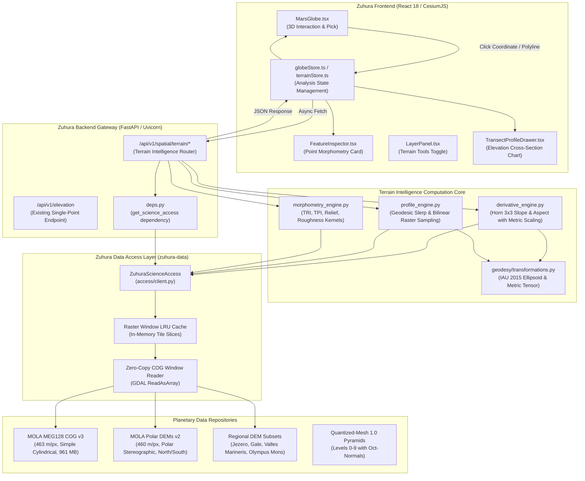

# ZUHURA — STAGE 8: SCIENTIFIC TERRAIN INTELLIGENCE
# Architecture and System Design Document

**Document Version:** 1.0.0  
**Phase:** Stage 8 Phase 1 (Architecture, Feasibility & Implementation Plan)  
**Status:** PROPOSED / PENDING APPROVAL  
**Target Platform:** Zuhura Integrated Planetary Digital Twin  
**Geodetic Reference:** IAU/IAG 2015 Mars Biaxial Ellipsoid ($A = 3,396,190\text{ m}$, $C = 3,376,200\text{ m}$)  
**Vertical Datum:** Mars Areoid (MOLA GMM-3 / MEG128 equipotential reference surface)  

---

## 1. Executive Overview & Scope

### 1.1 Purpose
Stage 8 elevates the Zuhura Mars Digital Twin from a high-fidelity **terrain visualization platform** (completed in Stage 7) to an **active scientific terrain intelligence system**. The objective is to provide planetary scientists, mission planners, and rover operations engineers with rigorous, quantitative, and reproducible morphometric analysis tools directly integrated into the digital twin.

### 1.2 Core Capabilities
1. **Point Terrain Intelligence:** Instantaneous derivation of elevation, slope (degrees), aspect (compass orientation $0^\circ - 360^\circ$), curvature, and roughness indices at any user-selected Martian coordinate.
2. **Latitude-Scaled Derivative Engine:** Geodetically rigorous finite-difference gradient calculations accounting for map-projection metric scale distortions on the Martian biaxial ellipsoid.
3. **Geodesic Transect Profiling:** Extraction of continuous elevation cross-sections along great-circle arcs or multi-segment polylines with cumulative geodesic distance, slope along transect, and hypsometric relief metrics.
4. **Local Morphometric Kernel Analysis:** Window-based focal statistics (kernel sizes $3\times 3$, $5\times 5$, $7\times 7$) computing Terrain Roughness Index (TRI), Topographic Position Index (TPI), standard deviation ($\sigma_z$), and local relief.
5. **Spatial Terrain Comparison:** Comparative morphometry between two arbitrary Martian sites, evaluating elevation delta, path gradient, distance, and morphometric divergence.
6. **Scientific Provenance & Uncertainty Reporting:** Every query response includes source dataset ID, nominal and metric ground resolution, vertical datum, processing method, and defensible uncertainty bounds.

### 1.3 Non-Disruption Guarantee
All Stage 8 capabilities are designed as modular extensions built strictly upon the existing verified infrastructure:
- **`zuhura-backend`**: Extends existing FastAPI services without modifying existing endpoints (`/api/v1/elevation`, `/api/v1/tiles/*`, `/api/v1/rasters/*`).
- **`zuhura-data`**: Reuses `ZuhuraScienceAccess` zero-copy COG window reading and catalog architecture without modifying existing processed rasters or Quantized-Mesh tiles.
- **`zuhura-frontend`**: Enhances `MarsGlobe.tsx`, `FeatureInspector.tsx`, and `LayerPanel.tsx` through non-breaking additive React components and state stores.

---

## 2. System Architecture & Data Flow

### 2.1 Layered Architecture Overview

The system architecture cleanly separates user interaction, API routing, mathematical computation, raster data extraction, and physical storage:

---

## 3. Geodetic & Mathematical Foundation

### 3.1 Mars Ellipsoid & Coordinate Standards
Planetary coordinate handling adheres strictly to the IAU/IAG Working Group on Cartographic Coordinates and Rotational Elements (WGCCRE 2015):
- **Equatorial Semi-Major Radius ($A$):** $3,396,190.0\text{ m}$
- **Polar Semi-Minor Radius ($C$):** $3,376,200.0\text{ m}$
- **Flattening ($f$):** $f = \frac{A - C}{A} = \frac{19,990.0}{3,396,190.0} \approx 0.0058860075$ ($1/f \approx 169.81$)
- **First Eccentricity Squared ($e^2$):** $e^2 = \frac{A^2 - C^2}{A^2} \approx 0.01173335$
- **Mean Volumetric Radius ($R_{\text{mean}}$):** $3,389,500.0\text{ m}$
- **Latitude Convention:** Planetocentric latitude ($\phi \in [-90^\circ, +90^\circ]$), measured from the equatorial plane to the center of mass.
- **Longitude Convention:** East-positive longitude ($\lambda \in [0^\circ, 360^\circ)$), with $0^\circ\text{E}$ fixed at the center of crater Airy-0.

### 3.2 The Map Projection Metric Tensor & Finite-Difference Scaling
The global MOLA DEM (`mola_global_meg128_cog.tif`) is formatted in an Equidistant Cylindrical (Simple Cylindrical) projection with standard parallel at $0^\circ$ and central meridian at $180^\circ\text{E}$ on a sphere of radius $R = 3,396,000\text{ m}$.

In this projection:
$$x = R (\lambda - \lambda_0) \frac{\pi}{180}, \quad y = R \phi \frac{\pi}{180}$$
The grid spacing at the equator is:
$$\Delta x_0 = \Delta y_0 = \frac{2\pi R}{360 \times 128} \approx 463.0577\text{ m}$$

#### The Crucial Latitudinal Distortion Problem
While the north-south grid distance $\Delta y$ remains constant across all latitudes:
$$\Delta y(\phi) \equiv \Delta y_0 \approx 463.0577\text{ m}$$
the physical east-west ground distance $\Delta x$ along a parallel of latitude $\phi$ contracts with the cosine of latitude:
$$\Delta x(\phi) = R \cos(\phi) \Delta \lambda = \Delta x_0 \cos(\phi)$$

If uncorrected, an algorithm that assumes isotropic pixel dimensions ($\Delta x = \Delta y = 463.06\text{ m}$) will compute:
$$\left(\frac{\partial z}{\partial x}\right)_{\text{uncorrected}} = \cos(\phi) \cdot \left(\frac{\partial z}{\partial x}\right)_{\text{true}}$$
This introduces catastrophic errors at mid and high latitudes:
- At $\phi = 0^\circ$ (Equator): $\cos(\phi) = 1.000$ (0% error).
- At $\phi = 18.38^\circ$ (Jezero Crater): $\cos(\phi) = 0.949$ (5.4% error in zonal gradient).
- At $\phi = 45^\circ$ (Mid-latitudes): $\cos(\phi) = 0.707$ (41.4% error in zonal gradient).
- At $\phi = 72.77^\circ$ (Korolev Crater): $\cos(\phi) = 0.296$ (238% error in zonal gradient).
- At $\phi = 85^\circ$ (Polar fringe): $\cos(\phi) = 0.087$ (1,049% error in zonal gradient).

#### Scientifically Rigorous Gradient Formulation
To eliminate projection distortion, Zuhura implements the **Metric Latitude-Scaled Horn (1981)** $3\times 3$ finite-difference operator. Given a $3\times 3$ elevation neighborhood centered at $(\phi_0, \lambda_0)$:

$$\begin{bmatrix} z_{tl} & z_{t} & z_{tr} \\ z_{l} & z_{0} & z_{r} \\ z_{bl} & z_{b} & z_{br} \end{bmatrix}$$

1. Evaluate the local metric ground cell dimensions at latitude $\phi_0$:
   $$\Delta x(\phi_0) = \Delta x_0 \cdot \cos(\phi_0)$$
   $$\Delta y(\phi_0) = \Delta y_0 = 463.0576672\text{ m}$$

2. Compute weighted partial derivatives:
   $$\frac{\partial z}{\partial x} = \frac{(z_{tr} + 2 z_r + z_{br}) - (z_{tl} + 2 z_l + z_{bl})}{8 \cdot \Delta x(\phi_0)}$$
   $$\frac{\partial z}{\partial y} = \frac{(z_{tl} + 2 z_t + z_{tr}) - (z_{bl} + 2 z_b + z_{br})}{8 \cdot \Delta y(\phi_0)}$$

3. Compute Surface Slope ($S$):
   $$S_{\text{rad}} = \arctan\left(\sqrt{\left(\frac{\partial z}{\partial x}\right)^2 + \left(\frac{\partial z}{\partial y}\right)^2}\right)$$
   $$S_{\text{deg}} = S_{\text{rad}} \times \frac{180}{\pi}, \quad S_{\text{deg}} \in [0^\circ, 90^\circ]$$

4. Compute Surface Aspect ($A$):
   Following international cartographic and planetary science standards ($0^\circ = \text{North}$, $90^\circ = \text{East}$, $180^\circ = \text{South}$, $270^\circ = \text{West}$):
   $$\theta = \operatorname{atan2}\left(\frac{\partial z}{\partial x}, -\frac{\partial z}{\partial y}\right)$$
   $$A_{\text{deg}} = (\theta \times \frac{180}{\pi}) \pmod{360}$$
   If $S_{\text{deg}} < 0.01^\circ$ (effectively flat terrain), $A_{\text{deg}}$ is classified as `null` with cardinal orientation `"flat"`.

---

## 4. Transect Profiling & Geodesic Interpolation Engine

### 4.1 Great-Circle Geodesic Arc Interpolation
For any two surface points $P_1(\phi_1, \lambda_1)$ and $P_2(\phi_2, \lambda_2)$, the transect path must follow the true planetary geodesic rather than a straight line in projected coordinates (which would introduce severe loxodromic distortion).

1. **Angular Arc Distance ($\sigma$):**
   $$\sigma = \arccos\left(\sin\phi_1 \sin\phi_2 + \cos\phi_1 \cos\phi_2 \cos(\lambda_2 - \lambda_1)\right)$$
2. **Total Geodesic Surface Distance ($D$):**
   $$D = R_{\text{mean}} \cdot \sigma = 3389500.0 \cdot \sigma \text{ (meters)}$$
3. **Spherical Linear Interpolation (Slerp):**
   For $N$ sample steps with fractional distance $f = i / (N - 1)$ where $i \in [0, N-1]$:
   Convert $P_1, P_2$ to unit Cartesian vectors $\mathbf{v}_1, \mathbf{v}_2$:
   $$\mathbf{v}(f) = \frac{\sin((1 - f)\sigma)}{\sin\sigma} \mathbf{v}_1 + \frac{\sin(f\sigma)}{\sin\sigma} \mathbf{v}_2$$
   Convert $\mathbf{v}(f) = (x_f, y_f, z_f)$ back to planetocentric coordinates:
   $$\phi_f = \arcsin(z_f), \quad \lambda_f = \operatorname{atan2}(y_f, x_f) \pmod{360}$$

### 4.2 Sub-Pixel Bilinear Elevation Extraction
Rather than crude nearest-neighbor rounding, profile elevations are sampled via bilinear interpolation across the 4 nearest DEM grid cells to prevent artificial stepped artifacts in slope and profile profiles:

$$z(\Delta u, \Delta v) = (1 - \Delta u)(1 - \Delta v) z_{00} + \Delta u (1 - \Delta v) z_{10} + (1 - \Delta u) \Delta v z_{01} + \Delta u \Delta v z_{11}$$

### 4.3 Profile Morphometric Summary Statistics
For each transect, the engine computes:
- Cumulative distance $d_i$ at each station $i$.
- Segment gradient: $\alpha_i = \arctan\left(\frac{z_{i} - z_{i-1}}{d_i - d_{i-1}}\right)$.
- Minimum elevation $z_{\min}$, Maximum elevation $z_{\max}$, Mean elevation $\bar{z}$.
- Total topographic relief: $\Delta z_{\text{relief}} = z_{\max} - z_{\min}$.
- Cumulative elevation gain: $\sum \max(0, z_{i} - z_{i-1})$.
- Cumulative elevation loss: $\sum \max(0, z_{i-1} - z_{i})$.
- Mean and peak slope along path.

---

## 5. Local Morphometry & Kernel Engine

For point inspection and localized landing site characterization, the system supports focal kernel analysis across $3\times 3$, $5\times 5$, and $7\times 7$ windows:

1. **Elevation Range / Local Relief ($\Delta z_k$):**
   $$\Delta z_k = \max(z_{i,j}) - \min(z_{i,j})$$
2. **Elevation Standard Deviation ($\sigma_z$):**
   $$\sigma_z = \sqrt{\frac{1}{K} \sum_{k=1}^K (z_k - \bar{z})^2}$$
3. **Terrain Roughness Index (TRI - Riley et al., 1999):**
   Evaluates local surface irregularity by computing the mean root-sum-square elevation difference between the center cell $z_0$ and all $K-1$ neighboring cells:
   $$\text{TRI} = \sqrt{\frac{\sum_{k=1}^{K-1} (z_k - z_0)^2}{K - 1}}$$
4. **Topographic Position Index (TPI - Weiss, 2001):**
   Identifies whether a cell sits on a ridge, flat plain, or depression:
   $$\text{TPI} = z_0 - \bar{z}_{\text{neighbors}}$$
   - $\text{TPI} > +5\text{ m}$: Local ridge, scarp crest, or crater rim.
   - $\text{TPI} \approx 0\text{ m}$: Flat plain, constant slope, or planar crater floor.
   - $\text{TPI} < -5\text{ m}$: Incised channel, pit crater, or canyon bottom.

---

## 6. Frontend Integration Architecture

### 6.1 `MarsGlobe.tsx` Integration
1. **Interactive Terrain Picking:** Uses Cesium's `ScreenSpaceEventHandler` on `LEFT_CLICK` when the Terrain Analysis mode is active.
2. **Transect Drawing Tool:**
   - Click start point $\rightarrow$ click end point (or drag line).
   - Renders a dynamic Cesium `PolylineGraphics` draped over terrain using `clampToGround: true` with dashed contrasting outline.
   - Emits coordinates to `terrainStore`.

### 6.2 `FeatureInspector.tsx` Integration
Expands the inspector dock with a new collapsible section:
- **Terrain Morphometry Card:** Displays live Slope, Aspect, Local Roughness (TRI), TPI classification, and Ground Resolution alongside existing MOLA Areoid elevation.

### 6.3 `TransectProfileDrawer.tsx` (New Component)
A dockable bottom drawer that slides up when a transect is measured:
- Renders a high-resolution interactive cross-section curve.
- Hovering over any point on the chart displays distance, elevation, and slope, while driving an animated position pin on the 3D Mars globe.
- Provides elevation gain/loss, max slope, and export buttons (JSON / CSV).

### 6.4 `LayerPanel.tsx` Integration
Adds a "Terrain Intelligence" toolbar containing:
- Measure Distance & Profile button.
- Point Slope & Aspect Inspector toggle.
- Morphometric kernel radius selector.

---

## 7. Performance & Caching Strategy

1. **Zero-Copy Window Extraction:** The GDAL Python binding directly reads $3\times 3$ to $15\times 15$ pixel windows from the local MOLA COG v3 file via TIFF tile block access without memory allocation spikes.
2. **LRU In-Memory Tile Cache:** An in-memory cache of $512\times 512$ pixel tiles is maintained in the backend service. Repeated queries in the same region (e.g. Jezero crater floor) resolve in $< 5\text{ ms}$ from cache.
3. **Optimized Transect Extraction:** 50-point profiles execute in $< 25\text{ ms}$ by extracting bounding-box windows from the COG in a single batch read rather than 50 separate disk queries.
4. **Bandwidth Efficiency:** JSON payloads are lightweight ($< 15\text{ KB}$ for a 200-sample transect), enabling 60 FPS UI interaction.

---

## 8. Summary of Architectural Impact

| Area | Nature of Change | Impact on Existing Code | Regression Risk |
| :--- | :--- | :--- | :---: |
| `zuhura-backend` | Additive router `/api/v1/spatial/terrain/*` & calculation modules | None (all existing routes untouched) | **ZERO** |
| `zuhura-data` | Additive methods on `ZuhuraScienceAccess` | None (existing query methods preserved) | **ZERO** |
| `zuhura-frontend` | Additive profile chart drawer & inspector extensions | None (existing globe view & layers preserved) | **ZERO** |
| Scientific Datasets | Read-only consumption of validated MOLA COG & Polar DEMs | None (no files written or overwritten) | **ZERO** |
