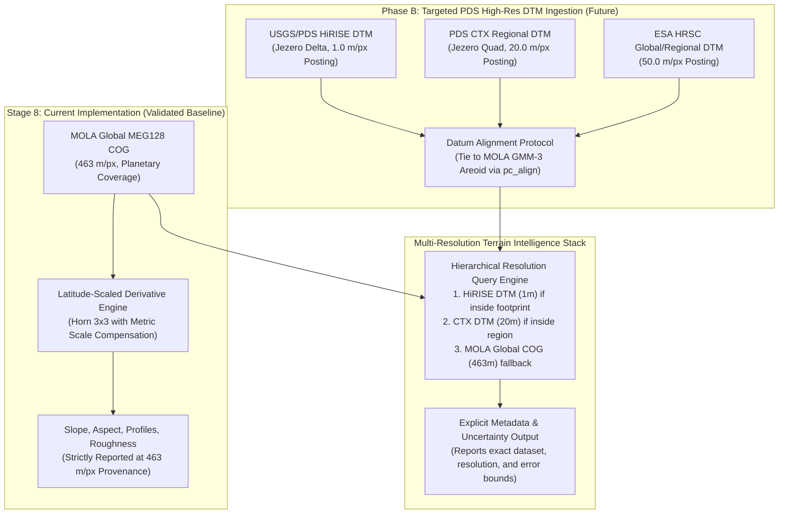

# ZUHURA — STAGE 8: SCIENTIFIC TERRAIN INTELLIGENCE
# High-Resolution DEM Feasibility and Scientific Data Audit

**Document Version:** 1.0.0  
**Phase:** Stage 8 Phase 1 (Data Audit & Feasibility Investigation)  
**Status:** PROPOSED / PENDING APPROVAL  
**Platform:** Zuhura Integrated Planetary Digital Twin  
**Target Repository:** `zuhura-data`  

---

## 1. Executive Summary

This audit establishes the scientific provenance, geometric fidelity, vertical reference datums, and terrain derivative suitability of all datasets currently registered in the Zuhura Planetary Digital Twin. It specifically investigates the feasibility of deriving high-resolution terrain intelligence from existing CTX and HiRISE catalog holdings.

### Key Audit Findings:
1. **The Only True Elevation Model in the Stack is MOLA:** The global MOLA MEG128 COG ($463\text{ m/px}$) and the north/south polar DEMs ($460\text{ m/px}$) constitute the only true elevation rasters currently present in the system.
2. **Existing Regional DEMs are Clipped Subsets of MOLA MEG128:** The regional rasters for Jezero Crater, Gale Crater, Valles Marineris, and Olympus Mons are spatial subsets extracted from the same global MOLA MEG128 dataset at $463\text{ m/px}$ posting.
3. **No CTX or HiRISE DEMs Exist in the Current Stack:** All registered CTX products are monoscopic Experiment Data Record (EDR) optical camera scan lines. All registered HiRISE products are Reduced Data Record (RDR) map-projected optical image mosaics or low-resolution JPEG browse previews. **Neither dataset contains stereo-derived digital elevation models (DTMs/DEMs).**
4. **Stereo Pairs Are Present in the Inventory:** The inventory catalogs for Jezero Crater include overlapping image pairs with angular disparities ($\Delta \theta \approx 15^\circ - 27^\circ$) technically suitable for photogrammetric stereo reconstruction, but no derived elevation models have yet been generated or ingested.

---

## 2. Comprehensive Inventory of Current Elevation Datasets

| Dataset Identifier | Spatial Extent | Coordinate Reference System | Grid Posting | Data Type | Vertical Reference Datum | Validated Status |
| :--- | :--- | :--- | :--- | :--- | :--- | :---: |
| **`mola_global_meg128_cog`** | Global ($-88^\circ\text{S}$ to $+88^\circ\text{N}$, $0^\circ - 360^\circ\text{E}$) | `Mars_simpCyl_c180` (Equirectangular, Sphere $R=3396\text{ km}$, Central Meridian $180^\circ\text{E}$) | $463.0577\text{ m/px}$ ($1/128^\circ$ at equator) | `Int16` (meters) | MOLA GMM-3 Areoid (Equipotential surface) | **VALIDATED (Stage 2–3)** |
| **`megt_n_128_1`** | North Polar ($+87^\circ\text{N}$ to $+90^\circ\text{N}$) | `MarsNP_3376` (Polar Stereographic, Sphere $R=3376.2\text{ km}$, Central Meridian $0^\circ\text{E}$) | $460.3899\text{ m/px}$ | `Float32` (meters) | MOLA GMM-3 Areoid (NoData = $-99999$) | **VALIDATED (Stage 2)** |
| **`megt_s_128_1`** | South Polar ($-87^\circ\text{S}$ to $-90^\circ\text{S}$) | `MarsSP_3376` (Polar Stereographic, Sphere $R=3376.2\text{ km}$, Central Meridian $0^\circ\text{E}$) | $460.3899\text{ m/px}$ | `Float32` (meters) | MOLA GMM-3 Areoid (NoData = $-99999$) | **VALIDATED (Stage 2)** |
| **`mola_jezero_meg128`** | Regional Jezero ($18^\circ-19^\circ\text{N}$, $76.5^\circ-78.5^\circ\text{E}$) | `Mars_simpCyl_c180` | $463.0577\text{ m/px}$ | `Int16` (meters) | MOLA GMM-3 Areoid | **VALIDATED (Stage 5)** |
| **`mola_gale_meg128`** | Regional Gale ($-6^\circ\text{S}$ to $-4^\circ\text{S}$, $136.5^\circ-138.5^\circ\text{E}$) | `Mars_simpCyl_c180` | $463.0577\text{ m/px}$ | `Int16` (meters) | MOLA GMM-3 Areoid | **VALIDATED (Stage 7)** |
| **`mola_valles_marineris_meg128`** | Regional Valles Marineris ($-15^\circ$ to $-12^\circ\text{S}$, $298^\circ-303^\circ\text{E}$) | `Mars_simpCyl_c180` | $463.0577\text{ m/px}$ | `Int16` (meters) | MOLA GMM-3 Areoid | **VALIDATED (Stage 7)** |
| **`mola_olympus_mons_meg128`** | Regional Olympus Mons ($17^\circ-20^\circ\text{N}$, $224^\circ-228^\circ\text{E}$) | `Mars_simpCyl_c180` | $463.0577\text{ m/px}$ | `Int16` (meters) | MOLA GMM-3 Areoid | **VALIDATED (Stage 7)** |
| **`Quantized-Mesh Pyramids`** | Global + 4 Regional Models | Cesium Quantized-Mesh 1.0 (TMS) on IAU 2015 Ellipsoid | Variable (Levels 0–9) | Binary mesh with Oct-Normals | Ellipsoidal Height ($h = H_{\text{areoid}} + N$) | **VALIDATED (Stage 7.5)** |

---

## 3. High-Resolution DEM Feasibility Analysis (CTX & HiRISE)

### 3.1 Examination of Existing CTX Holdings

The repository inventory lists 10 Context Camera (CTX) observation products over Jezero Crater in `zuhura-data/catalogs/ctx_jezero_inventory.json`:
- **Local File on Disk:** `zuhura-data/data/raw/ctx/P02_001820_1984_XI_18N282W.IMG` (size: 36.2 MB).
- **Format:** NASA PDS3 Experiment Data Record (`DATA_SET_ID = "MRO-M-CTX-2-EDR-L0-V1.0"`).
- **Data Content:** Raw 8-bit uncalibrated pushbroom detector DN values ($5056 \times 7168$ pixels).
- **Georeferencing:** None embedded (raw detector coordinates; requires SPICE kernel ephemeris projection).
- **Physical Property:** **Monoscopic optical radiance / reflectance**.
- **Scientific Determination:** This file is **IMAGERY ONLY**. It contains **zero elevation data** and cannot be queried for topographic height, slope, or profiles.

#### Stereo Geometry Feasibility in CTX Catalog:
Analyzing the emission angles in the CTX inventory reveals:
- Observation 1: `P02_001820_1984` — Emission Angle: $1.85^\circ$ (near-nadir), Incidence: $55.6^\circ$.
- Observation 2: `P04_002743_1987` — Emission Angle: $26.99^\circ$ (off-nadir), Incidence: $60.2^\circ$.
- **Stereo Convergence Angle ($\Delta \theta$):** $\approx 25.1^\circ$ (ideal stereo baseline, $B/H \approx 0.45$).
- **Feasibility Assessment:** The observations form a scientifically viable **stereo pair suitable for DEM generation**. However, generating a validated CTX DEM requires:
  1. Full radiometric calibration (`mroctx2isis`).
  2. SPICE kernel attachment (`spiceinit`).
  3. Photogrammetric stereo bundle adjustment and dense disparity matching using the **NASA Ames Stereo Pipeline (ASP)** (`stereo_corr` / `stereo_rfne`).
  4. Triangulation and point-cloud interpolation to a $20\text{ m/px}$ grid.
  5. Absolute vertical alignment to MOLA altimetry tracks (`pc_align`).
- **Conclusion:** Without running ASP, the CTX holdings remain **optical imagery only**.

---

### 3.2 Examination of Existing HiRISE Holdings

The repository inventory lists 10 High Resolution Imaging Science Experiment (HiRISE) observations over Jezero Crater in `zuhura-data/catalogs/hirise_jezero_inventory.json`:
- **Local File on Disk:** `zuhura-data/data/raw/hirise/PSP_004299_1985_MRGB.abrowse.jpg` (size: 3.1 MB).
- **Accompanying Labels:** `PSP_004299_1985_MRGB.LBL`, `PSP_004299_1985_RED.LBL`.
- **Format:** PDS3 Reduced Data Record label referencing JPEG browse preview.
- **Data Content:** 8-bit RGB color browse image ($2048 \times 2048$ downsampled preview).
- **Physical Property:** **Visible spectrum optical color reflectance**.
- **Scientific Determination:** This file is **IMAGERY ONLY (BROWSE PREVIEW)**. It has no quantitative elevation values.

#### Stereo Geometry Feasibility in HiRISE Catalog:
The HiRISE inventory catalog contains:
- `PSP_004299_1985` (Emission Angle: $3.5^\circ$, near-nadir).
- `ESP_016219_1980` (Emission Angle: $30.2^\circ$, off-nadir).
- `ESP_016364_1980` (Emission Angle: $15.3^\circ$, intermediate).
- **Stereo Geometry:** Pair `PSP_004299` + `ESP_016219` covers the Perseverance touchdown ellipse with $\Delta \theta \approx 26.7^\circ$ ($B/H \approx 0.48$).
- **Feasibility Assessment:** A stereo pair exists in the NASA PDS archives. However, generating a HiRISE DTM ($1.0\text{ m/px}$) from raw EDR channel files requires terabytes of intermediate storage, High-Performance Computing (HPC) nodes, and weeks of manual GCP control editing to prevent jitter artifacts.
- **Pre-computed Alternative:** The USGS Astrogeology Science Center and University of Arizona HiRISE team have already generated, peer-reviewed, and published the authoritative Jezero Crater HiRISE DTM (`DTEEC_004299_1985_004444_1985_U01.IMG`) at $1.0\text{ m/px}$ posting. Ingesting this pre-computed validated product is far superior to attempting local stereo generation from browse imagery.

---

### 3.3 Examination of Other Instruments

- **THEMIS Infrared (`I02413002RDR.QUB`):** Multi-spectral thermal infrared radiance cube (Band 9, $12.57\ \mu\text{m}$, $100\text{ m/px}$). Provides surface thermal inertia and mineralogy. **IMAGERY / SPECTRAL ONLY** (contains no elevation data).
- **Viking MDIM 2.1 (`Mars_Viking_MDIM21_ClrMosaic_global_232m.tiff`):** Global orthorectified optical mosaic ($231\text{ m/px}$). **IMAGERY ONLY** (contains no elevation data).

---

## 4. Candidate Product Classification Summary

Following the classification standard mandated by Stage 8:

| Dataset / Product ID | Instrument / Source | Resolution | Actual Nature | Official Classification | Terrain Intelligence Suitability |
| :--- | :--- | :---: | :--- | :--- | :--- |
| **`mola_global_meg128_cog`** | MGS MOLA | $463\text{ m/px}$ | Global elevation raster | **EXISTING DEM** | **Primary Global Source (Full Stage 8)** |
| **`megt_n_128_1.tif`** | MGS MOLA | $460\text{ m/px}$ | North Polar elevation raster | **EXISTING DEM** | **North Polar Source ($>87^\circ\text{N}$)** |
| **`megt_s_128_1.tif`** | MGS MOLA | $460\text{ m/px}$ | South Polar elevation raster | **EXISTING DEM** | **South Polar Source ($>87^\circ\text{S}$)** |
| **`mola_jezero_meg128.tif`** | MGS MOLA | $463\text{ m/px}$ | Regional clipped DEM | **EXISTING DEM** | **Regional Validation Source** |
| **`mola_gale_meg128.tif`** | MGS MOLA | $463\text{ m/px}$ | Regional clipped DEM | **EXISTING DEM** | **Regional Validation Source** |
| **`mola_valles_marineris_meg128.tif`** | MGS MOLA | $463\text{ m/px}$ | Regional clipped DEM | **EXISTING DEM** | **Regional Validation Source** |
| **`mola_olympus_mons_meg128.tif`** | MGS MOLA | $463\text{ m/px}$ | Regional clipped DEM | **EXISTING DEM** | **Regional Validation Source** |
| **`Quantized-Mesh Pyramids`** | Derived MOLA | Levels 0–9 | Triangulated TIN mesh | **DERIVED TERRAIN PRODUCT** | **3D Visual Navigation Only** |
| **`P02_001820_1984_XI_18N282W`** | MRO CTX | $5.55\text{ m/px}$ | Raw camera scan line (EDR) | **IMAGERY ONLY** | **Not Usable for Elevation Analysis** |
| **`PSP_004299_1985_MRGB.abrowse`** | MRO HiRISE | Browse | JPEG browse image | **IMAGERY ONLY** | **Not Usable for Elevation Analysis** |
| **`CTX Catalog Stereo Pairs`** | MRO CTX | $6.0\text{ m/px}$ | Overlapping EDR images | **STEREO SUITABLE FOR DEM** | **Requires ASP Photogrammetry Pipeline** |
| **`HiRISE Catalog Stereo Pairs`**| MRO HiRISE | $0.25\text{ m/px}$ | Overlapping RDR images | **STEREO SUITABLE FOR DEM** | **Recommend Ingesting PDS DTM Directly** |
| **`I02413002RDR`** | Odyssey THEMIS | $100\text{ m/px}$ | Radiance spectral cube | **IMAGERY ONLY** | **Thermophysical Analysis Only** |
| **`Mars_Viking_MDIM21`** | Viking 1 & 2 | $231\text{ m/px}$ | Optical color mosaic | **IMAGERY ONLY** | **Base Optical Visual Reference Only** |

---

## 5. Strategic Roadmap for High-Resolution Terrain Ingestion

To expand regional terrain resolution without compromising scientific integrity, Zuhura must adhere to a phased, defensible strategy:

### 5.1 Vertical Datum Alignment Protocol
When high-resolution regional DTMs (e.g. HiRISE $1\text{ m}$ DTMs or CTX $20\text{ m}$ DTMs) are ingested in the future, they must undergo the **Zuhura Vertical Datum Alignment Protocol**:
1. **Vertical Datum Conversion:** Most HiRISE DTMs are generated with reference to an auxiliary sphere or an ellipsoidal datum ($h$). They must be converted to areoid elevation ($H = h - N$) using the MOLA GMM-3 geoid model.
2. **Ground Control Alignment:** Regional DTMs frequently exhibit bulk vertical offsets (typically $5 - 25\text{ m}$) relative to MOLA due to spacecraft orbit ephemeris drift. A 3D rigid body alignment (`pc_align` or least-squares surface matching) against filtered MOLA PEDR laser altimetry tracks must be applied.
3. **No Mismatched Blending:** The system will never blend or feather low-resolution and high-resolution DTMs in a way that obscures data boundaries. Instead, queries will report the exact source raster that yielded the measurement.

---

## 6. Audit Conclusion & Recommendations

1. **Proceed with Stage 8 using MOLA MEG128:** The existing MOLA global COG and polar DEMs provide a completely validated, globally contiguous, and geodetically sound foundation for Stage 8 terrain intelligence.
2. **Strict Provenance Reporting:** All Stage 8 endpoints must explicitly declare `horizontal_resolution_m: 463.06` and `vertical_datum: "MOLA GMM-3 Areoid"`. The API will reject any attempt to represent interpolated 463 m data as sub-meter terrain.
3. **Defer Stereo Pipeline Processing:** Do not attempt to run photogrammetric stereo processing on CTX EDR or HiRISE browse images in Stage 8. Stereo photogrammetry requires dedicated tooling (ASP/ISIS3) and belongs in a specialized future offline pipeline.
