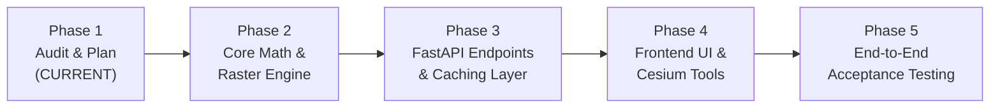

# ZUHURA — STAGE 8: SCIENTIFIC TERRAIN INTELLIGENCE
# Implementation Plan and Work Breakdown Structure

**Document Version:** 1.0.0  
**Phase:** Stage 8 Phase 1 (Implementation Plan)  
**Status:** PROPOSED / PENDING APPROVAL  
**Target Completion:** Stage 8  
**Scope:** Multi-Repository Implementation across `zuhura-backend`, `zuhura-data`, and `zuhura-frontend`  

---

## 1. Implementation Methodology & Phased Roadmap

Stage 8 implementation will proceed in five distinct, strictly sequential phases. Each phase establishes a solid, tested foundation before the next phase is unlocked. Non-regression of Stages 1–7 deliverables is guaranteed throughout.



| Phase | Focus Area | Deliverables / Milestone | Status |
| :---: | :--- | :--- | :---: |
| **Phase 1** | **Architecture & Audit** | Architecture, feasibility audit, API design, implementation plan, acceptance criteria. | **COMPLETE (Ready for Approval)** |
| **Phase 2** | **Computation Core** | Metric Horn slope/aspect engine, geodesic Slerp profiler, TRI/TPI morphometry modules in `zuhura-backend` & `zuhura-data`. | **PLANNED** |
| **Phase 3** | **API & Caching** | `/api/v1/spatial/terrain/*` endpoints, Pydantic schemas, unit/integration test suites, Swagger docs. | **PLANNED** |
| **Phase 4** | **Frontend UI** | Interactive Cesium transect polyline, `FeatureInspector.tsx` morphometry card, `TransectProfileDrawer.tsx` chart. | **PLANNED** |
| **Phase 5** | **Acceptance & Report** | Automated Selenium visual acceptance, performance benchmarks, final Stage 8 acceptance report. | **PLANNED** |

---

## 2. File Organization & Repository Mapping

All modifications are strictly additive. No existing files from Stages 1–7 are deleted or overwritten.

```text
/home/anonymous/Zuhura/
├── zuhura-backend/
│   ├── src/zuhura/
│   │   ├── terrain_intelligence/               # [NEW MODULE]
│   │   │   ├── __init__.py
│   │   │   ├── derivatives.py                  # Metric Horn 3x3 slope & aspect
│   │   │   ├── profiler.py                     # Geodesic Slerp & bilinear elevation sampling
│   │   │   ├── morphometry.py                  # TRI, TPI, local relief & roughness
│   │   │   └── cache.py                        # LRU in-memory raster tile cache
│   │   ├── api/v1/
│   │   │   ├── terrain.py                      # [NEW ROUTE] Endpoints for point, profile, stats, compare
│   │   │   └── spatial.py                      # [UPDATED] Mounts terrain sub-router
│   │   └── schemas/
│   │       └── terrain.py                      # [NEW SCHEMAS] Pydantic v2 request/response models
│   └── tests/
│       ├── unit/terrain/                       # [NEW TESTS]
│       │   ├── test_derivatives_metric.py
│       │   ├── test_geodesic_profiler.py
│       │   └── test_morphometry.py
│       └── integration/api/
│           └── test_stage8_terrain_api.py      # [NEW INTEGRATION TESTS]
│
├── zuhura-data/
│   ├── src/zuhura_data/
│   │   └── access/
│   │       └── client.py                       # [UPDATED] Add batch window & sub-pixel sampling methods
│   └── tests/
│       └── test_stage8_terrain_access.py       # [NEW TESTS]
│
├── zuhura-frontend/
│   ├── src/
│   │   ├── components/
│   │   │   ├── TransectProfileDrawer.tsx       # [NEW] Bottom dockable elevation cross-section chart
│   │   │   ├── FeatureInspector.tsx            # [UPDATED] Adds Morphometry / Terrain Intelligence card
│   │   │   ├── LayerPanel.tsx                  # [UPDATED] Adds Terrain Analysis toggle toolbar
│   │   │   └── MarsGlobe.tsx                   # [UPDATED] Adds transect polyline drawing handler
│   │   ├── store/
│   │   │   └── terrainAnalysisStore.ts         # [NEW] State management for transect & point analysis
│   │   └── lib/terrain/
│   │       └── terrainApiClient.ts             # [NEW] Typed API client for terrain endpoints
│   └── tests/
│       └── terrainAnalysis.test.ts             # [NEW FRONTEND TESTS]
│
└── reports/stage8/
    ├── stage8_architecture.md                  # [DELIVERED Phase 1]
    ├── stage8_data_feasibility_audit.md        # [DELIVERED Phase 1]
    ├── stage8_api_design.md                    # [DELIVERED Phase 1]
    ├── stage8_implementation_plan.md            # [DELIVERED Phase 1]
    ├── stage8_acceptance_criteria.md           # [DELIVERED Phase 1]
    └── stage8_final_acceptance_report.md       # [To be generated in Phase 5]
```

---

## 3. Technology Stack & Dependencies

The implementation relies entirely on existing, pre-installed, and validated dependencies. No external packages or invasive system libraries will be introduced.

| Component | Dependency | Existing Version in Zuhura | Role in Stage 8 |
| :--- | :--- | :--- | :--- |
| **Backend Runtime** | Python | `3.14.8` | Core execution environment |
| **API Gateway** | FastAPI / Starlette | `0.115.6` | HTTP routing, dependency injection, validation |
| **ASGI Server** | Uvicorn | `0.34.0` | Asynchronous request serving |
| **Data Validation** | Pydantic | `2.10.6` | Strict schema serialization and boundary checks |
| **Spatial / Geospatial** | GDAL / OGR (`osgeo`) | `3.10.1` | Zero-copy GeoTIFF window reads, projection handling |
| **Numerical Processing**| NumPy | `2.2.3` | Matrix finite differences, vector math, statistics |
| **Testing Engine** | Pytest / Pytest-Asyncio| `9.2.0` / `1.4.1` | Unit and asynchronous API integration tests |
| **Frontend Framework** | React / TypeScript | `18.3.1` / `5.6.3` | UI components, reactive state stores |
| **3D Rendering** | CesiumJS | `1.124.0` | Mars ellipsoid globe, interactive picking, polylines |
| **Visual Automation** | Selenium / Chromium | `4.27.1` / `154.0` | Headless visual acceptance testing & screenshot capture |

---

## 4. Step-by-Step Task Breakdown & Sequencing

| Task ID | Component | Task Description | Dependencies | Est. Complexity |
| :---: | :--- | :--- | :---: | :---: |
| **T-8.1** | `zuhura-data` | Add `read_raster_window_batch` and `sample_bilinear_subpixel` to `ZuhuraScienceAccess`. | None | **Low (2h)** |
| **T-8.2** | `zuhura-backend` | Implement `derivatives.py` with latitude-scaled Horn 3x3 finite-difference operator. | T-8.1 | **Medium (3h)** |
| **T-8.3** | `zuhura-backend` | Implement `profiler.py` with great-circle Slerp interpolation and monotonic distance tracking. | T-8.1 | **Medium (3h)** |
| **T-8.4** | `zuhura-backend` | Implement `morphometry.py` with TRI, TPI, local relief, and standard deviation kernels. | T-8.2 | **Low (2h)** |
| **T-8.5** | `zuhura-backend` | Implement Pydantic v2 schemas in `schemas/terrain.py` with coordinate normalization. | None | **Low (1h)** |
| **T-8.6** | `zuhura-backend` | Create `/api/v1/spatial/terrain/*` router and register endpoints with dependency injection. | T-8.2 – T-8.5 | **Medium (3h)** |
| **T-8.7** | `zuhura-backend` | Build comprehensive unit and integration tests (`test_stage8_terrain_api.py`). | T-8.6 | **Medium (3h)** |
| **T-8.8** | `zuhura-frontend` | Create `terrainAnalysisStore.ts` and `terrainApiClient.ts` for typed frontend state. | T-8.6 | **Low (2h)** |
| **T-8.9** | `zuhura-frontend` | Build `TransectProfileDrawer.tsx` (interactive cross-section chart with hover cursor). | T-8.8 | **Medium (4h)** |
| **T-8.10**| `zuhura-frontend` | Enhance `FeatureInspector.tsx` with live Morphometry card (Slope, Aspect, TRI, TPI). | T-8.8 | **Low (2h)** |
| **T-8.11**| `zuhura-frontend` | Update `MarsGlobe.tsx` with interactive transect polyline drawing and terrain clamping. | T-8.9 | **Medium (3h)** |
| **T-8.12**| `zuhura-frontend` | Integrate analysis tool buttons into `LayerPanel.tsx`. | T-8.11 | **Low (1h)** |
| **T-8.13**| Full Stack | Execute automated Selenium visual acceptance suite and capture evidence screenshots. | T-8.1 – T-8.12| **Medium (3h)** |
| **T-8.14**| Documentation | Generate final Stage 8 acceptance report and update technical documentation. | T-8.13 | **Low (2h)** |

**Total Estimated Implementation Effort:** $\approx 34$ Hours.

---

## 5. Risk Analysis & Mitigation Matrix

| Risk ID | Risk Description | Severity | Likelihood | Mitigation Strategy |
| :---: | :--- | :---: | :---: | :--- |
| **R-01** | **Latitudinal Scale Distortion:** Inaccurate slope calculation at high latitudes due to meridian convergence. | **High** | **High** | Strictly enforce metric tensor scaling: $\Delta x(\phi) = \Delta x_0 \cos(\phi)$ in all finite-difference calculations. |
| **R-02** | **Polar Boundary Discontinuity:** Out-of-bounds error when query latitude exceeds $\pm 88^\circ$. | **Medium** | **Medium** | Implement automatic routing to Polar Stereographic DEMs (`megt_n_128_1.tif`) with explicit CRS metadata in response. |
| **R-03** | **Transect Memory Spikes:** User requesting 500 samples across the planet triggering massive raster load. | **Medium** | **Low** | Read only bounding-box window or point-sample directly; clamp maximum sample count to 500 and maximum distance to $10,000\text{ km}$. |
| **R-04** | **Antimeridian / Origin Wrap:** Profile crossing $0^\circ/360^\circ$ or $180^\circ$ failing on array index lookups. | **High** | **Medium** | Implement modulo normalization on all coordinate lookups and handle window splits across $0^\circ\text{E}$ boundary. |
| **R-05** | **Terrain Clamping Failure in UI:** Polyline sinking below Cesium 3D terrain surface. | **Medium** | **Medium** | Use Cesium `clampToGround: true` on PolylineGraphics and query height via `scene.globe.getHeight()`. |
| **R-06** | **Misrepresenting Resolution:** Interpolated 463 m MOLA data perceived as high-resolution rover terrain. | **Critical** | **Low** | Mandate explicit provenance block in every API response declaring source resolution ($463\text{ m/px}$) and uncertainty. |

---

## 6. Execution Boundaries & Non-Regression Rules

1. **No Production API Modification:** Existing `/api/v1/elevation` and `/api/v1/rasters/*` remain intact and functional.
2. **No Dataset Re-writes:** `mola_global_meg128_cog.tif`, regional subsets, and Quantized-Mesh tiles are consumed strictly in read-only mode.
3. **Automated Regression Testing:** Before declaring any milestone complete, all Stage 1–7 test suites (27 backend tests, 33 zuhura-data tests, 4 frontend tests) must pass with zero failures.
4. **Gate Review:** Implementation will not commence until the USER reviews and approves this Phase 1 Architecture and Plan.
